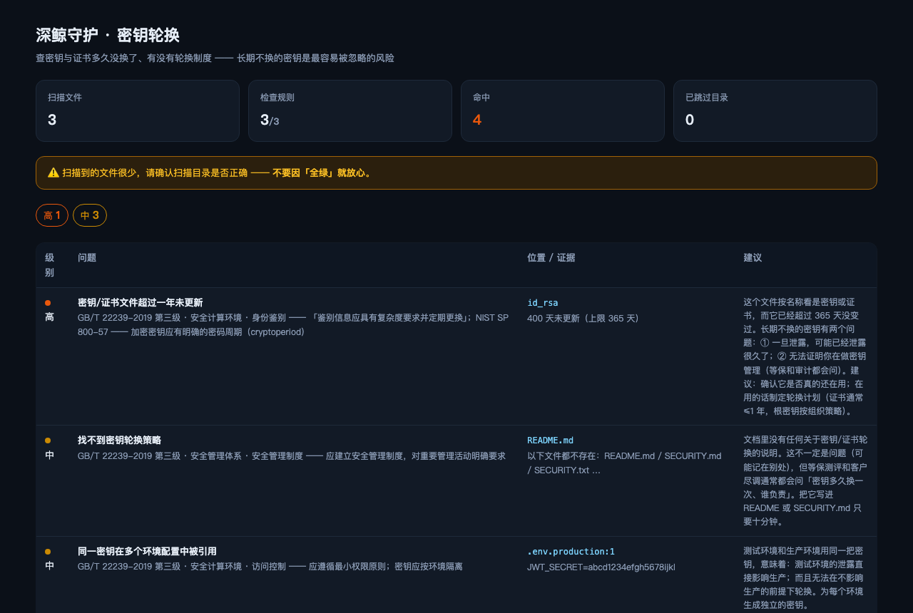

# @deepwhale-cn/dsh-key-rotate

[](https://dsh-plugin.org/plugins/feely0208/dsh-key-rotate)

**密钥轮换** —— 查密钥与证书多久没换了、有没有轮换制度、有没有跨环境复用。

## 不装它会怎样

你的 `id_rsa` 是两年前配的，一直没动。制度文档也许写了「密钥每年轮换」。

**但事实上它就是没换过。**

等保测评会问「鉴别信息多久更换一次」，客户尽调会问「密钥管理流程」——
你拿不出证据，因为**文件时间戳就摆在那里**。

## 它查什么

| 级别 | 内容 |
|---|---|
| 🔴 高 | 密钥/证书文件超过一年未更新（按 mtime）|
| 🟡 中 | 文档里找不到轮换策略 |
| 🟡 中 | 同一密钥在多个环境配置里被引用 |

## 为什么这是可判定的

```
密钥文件 mtime → 距今多少天 → 对比阈值（默认 365 天）
```

制度写在纸上，**时间戳不会说谎**。

## 安装

```bash
dsh plugin --profile web add @deepwhale-cn/dsh-key-rotate
# 或纯 CLI
npx @deepwhale-cn/dsh-key-rotate
```

## 用法

```bash
dsh-key-rotate --demo          # 看检出效果
dsh-key-rotate --list-rules    # 列出规则和依据
dsh-key-rotate --html r.html
```



## 边界

- **年龄 ≠ 未轮换** —— 密钥可能在 KMS 里，本地只是副本。报出来需你确认。
- **不解析证书内容** —— 不校验有效期、签发者、密钥长度。
- **跨环境复用只看 .env 类文件** —— KMS / CI secrets 看不到。
- 与 [dsh-secret-scan](https://github.com/feely0208/dsh-cn-skills) 分工：那个查「密钥有没有被提交」，这个查「多久没换」。

本插件是一个工具。使用者必须遵守所在地区法律法规，**对使用本项目造成的任何后果自行承担责任。**

## License

MIT © 深鲸 DeepWhale
